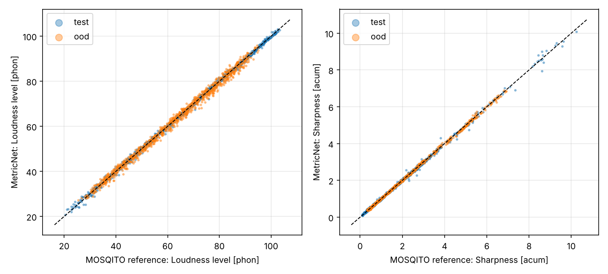
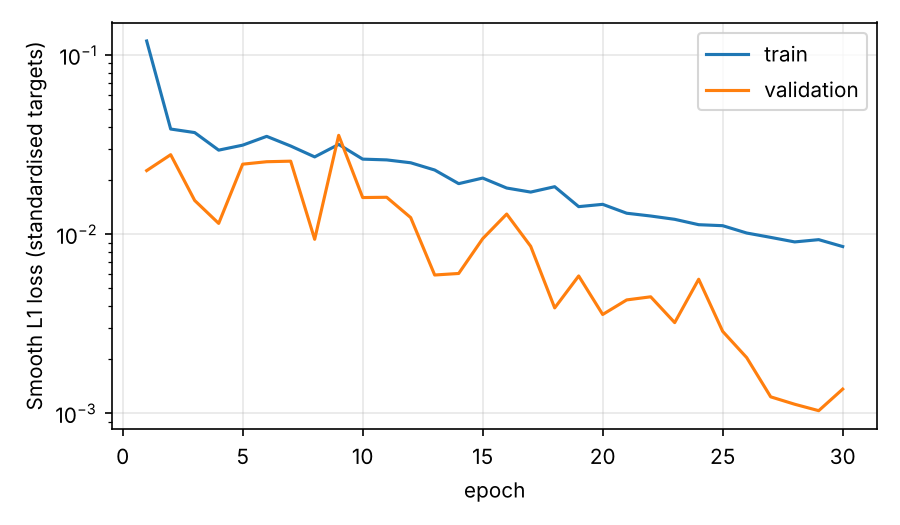

# Neural estimation of psychoacoustic loudness and sharpness

A convolutional network that estimates stationary **loudness (ISO 532-1, Zwicker method)** and **sharpness (DIN 45692)** directly from calibrated audio. The model is trained on synthetic signals whose reference values are computed with [MOSQITO](https://github.com/Eomys/MoSQITo), and is evaluated against those references, against two linear baselines, and on a held-out signal family that it never sees during training.

On the in-distribution test set the network reaches a mean absolute error of **0.43 phon** in loudness level and **0.030 acum** in sharpness. On the unseen family (amplitude-modulated tones) the errors are 1.10 phon and 0.028 acum. Inference is about 35 times faster than the reference implementation on CPU and, unlike it, fully differentiable.



## Motivation

Sound quality metrics such as loudness and sharpness are defined by standardised, auditory-model-based procedures. They are cheap enough to run on single recordings, but two use cases call for something different:

- **Differentiability.** A neural surrogate can be used as a loss term or a constraint when training other audio models, for example to penalise changes in perceived loudness or sharpness introduced by a processing network.
- **Throughput.** Batched evaluation on CPU or GPU makes it practical to annotate large datasets.

The project also serves as a controlled study of a common question in audio machine learning: how well does a model trained on generated data reproduce a physically and perceptually defined quantity, and where does it fail?

## Method

### Data generation

Every example is a 1 s, 48 kHz pressure signal in pascal, presented at a random level between 30 and 90 dB SPL and faded in and out with 10 ms raised-cosine ramps. Seven signal families are implemented in [`signals.py`](src/psychonet/signals.py):

| Family | Parameters drawn at random | Split |
|---|---|---|
| Pure tone | frequency 50 Hz to 12 kHz (log-uniform) | train / val / test |
| Harmonic complex | f0 80 Hz to 1 kHz, 2 to 24 partials, spectral slope 0 to -12 dB/oct | train / val / test |
| White noise | band-limited 20 Hz to 12 kHz | train / val / test |
| Coloured noise | spectral slope -6 to +3 dB/oct | train / val / test |
| Band-pass noise | centre 100 Hz to 10 kHz, bandwidth 1/12 to 2 octaves | train / val / test |
| Tone in noise | tone plus coloured noise, SNR -10 to +20 dB | train / val / test |
| AM tone | carrier 250 Hz to 8 kHz, modulation 30 to 150 Hz, depth 0.2 to 1 | out-of-distribution only |

Reference values are computed with MOSQITO for a free sound field: `loudness_zwst` for ISO 532-1 stationary loudness and `sharpness_din_from_loudness` for DIN 45692 sharpness. Examples below 0.1 sone are discarded, because sharpness is normalised by total loudness and becomes numerically unstable near the hearing threshold (about 0.5 % of the data).

Splits: 12 000 train, 1 500 validation, 1 500 test, 1 000 out-of-distribution.

### Front end

Loudness depends on absolute level, so the input is **not** normalised per clip. [`features.py`](src/psychonet/features.py) implements a calibrated log-mel front end in PyTorch (4096-point Hann STFT, 50 ms hop, 128 triangular mel bands from 20 Hz to 16 kHz). Power is scaled so that band powers add up to the mean-square pressure of the signal, and band levels are expressed in dB SPL. The unit tests check that, for pure tones at 125 Hz, 1 kHz and 6.3 kHz, the summed band power matches the nominal 70 dB SPL within 0.5 dB.

### Targets

- **Loudness level in phon** rather than loudness in sone. Phon is roughly linear in level, which gives a well-conditioned regression target, and the error is directly interpretable (the just-noticeable difference in level is on the order of 1 dB). Sone values are recovered with the inverse ISO 532-1 relation.
- **Sharpness in acum.**

Both targets are standardised using training-set statistics.

### Model

`MetricNet` ([`model.py`](src/psychonet/model.py)) is a three-stage CNN (24, 48 and 96 channels; two 3x3 convolutions with batch normalisation per stage, followed by 2x2 max pooling). The time axis is averaged after the convolutional stack because the metrics are stationary. The frequency axis is kept and flattened into a two-layer head, since the position of energy on the frequency scale is essential for both metrics. The network has 0.56 M parameters.

Training uses AdamW (weight decay 1e-4), a one-cycle learning-rate schedule with a peak of 2e-3, Smooth L1 loss, batch size 64 and 30 epochs. The checkpoint with the lowest validation loss is kept.



Validation loss is below training loss because dropout and batch-normalisation batch statistics are only active during training.

## Results

| Split | Model | Loudness MAE [phon] | Loudness r | Sharpness MAE [acum] | Sharpness r |
|---|---|---|---|---|---|
| test | MetricNet | **0.43** | 1.000 | **0.030** | 0.999 |
| test | Linear on band levels | 10.40 | 0.731 | 0.586 | 0.640 |
| test | Linear on overall SPL | 6.41 | 0.922 | 1.022 | 0.027 |
| ood | MetricNet | **1.10** | 0.997 | **0.028** | 1.000 |
| ood | Linear on band levels | 15.54 | 0.360 | 1.000 | 0.638 |
| ood | Linear on overall SPL | 5.87 | 0.989 | 1.262 | -0.012 |

Error per signal family (MetricNet):

| Family | n | Loudness MAE [phon] | Sharpness MAE [acum] |
|---|---|---|---|
| White noise | 248 | 0.18 | 0.017 |
| Coloured noise | 254 | 0.25 | 0.017 |
| Harmonic complex | 241 | 0.44 | 0.027 |
| Band-pass noise | 250 | 0.48 | 0.030 |
| Tone in noise | 256 | 0.52 | 0.055 |
| Pure tone | 236 | 0.68 | 0.032 |
| AM tone (unseen) | 1000 | 1.10 | 0.028 |

Runtime on a 2-core CPU: MOSQITO 45.8 ms per clip, MetricNet 1.3 ms per clip (batched, front end included).

### Discussion

- **Baselines.** Overall SPL explains much of the loudness variance (r = 0.92) but ignores frequency weighting and spectral masking, and it carries no information about sharpness (r close to 0), as expected for a level-independent quantity. A linear model on band levels does worse than overall SPL for loudness: averaging dB values is not the same as summing power, and narrowband signals leave most bands at the floor value. Both points illustrate why the problem needs a non-linear model.
- **Where the error comes from.** Broadband noise is the easiest case. Tonal signals have larger errors, because a single partial falls between mel bands and the network has to infer its exact frequency from the ratio of two band levels. The largest sharpness errors are for very high sharpness values (above 8 acum), which come mostly from high-frequency pure tones and are sparse in the training data.
- **Generalisation.** On amplitude-modulated tones, which never appear in training, sharpness transfers almost perfectly, while loudness error grows to 1.1 phon (mean bias -0.18 phon, so the increase is mostly variance rather than a systematic offset). Modulation spreads energy into sidebands, a pattern that resembles the tone-in-noise family but is not identical to it.

### Limitations

- The reference is the MOSQITO implementation, not a certified one, and only stationary metrics in a free field are covered. Time-varying loudness (ISO 532-1 Annex B, ECMA-418-2) and roughness are natural extensions.
- The training data are synthetic and stationary. Performance on recorded, non-stationary sounds has not been validated.
- The front end uses a mel scale with fixed resolution rather than a Bark or ERB filterbank. A front end matched to the critical-band scale is likely to reduce the error on tonal signals.

## Usage

```bash
python -m venv .venv
source .venv/bin/activate            # Windows: .venv\Scripts\activate
pip install -e ".[dev]"

python -m psychonet.generate --workers 4      # about 7 min on 2 cores
python -m psychonet.train
python -m psychonet.evaluate
pytest
```

Estimate the metrics of a calibrated recording, where `--pa-per-unit` is the sound pressure in Pa that corresponds to a digital full-scale value of 1.0:

```bash
python -m psychonet.inference recording.wav --pa-per-unit 2.0
```

All settings are in [`configs/default.yaml`](configs/default.yaml), and every random draw is seeded so that the dataset and results can be reproduced.

## Repository structure

```
configs/default.yaml      experiment configuration
src/psychonet/
    signals.py            calibrated synthetic signal families
    references.py         MOSQITO reference metrics, phon/sone conversion
    features.py           calibrated log-mel front end
    generate.py           parallel dataset generation
    data.py               dataset, filtering and standardisation
    model.py              MetricNet
    train.py              training loop with early stopping
    evaluate.py           metrics, baselines, figures, runtime benchmark
    inference.py          estimator class and command-line tool for WAV files
tests/                    unit tests for signals, front end and model
results/                  metrics and figures reported above
```

## References

- ISO 532-1:2017, *Acoustics - Methods for calculating loudness - Part 1: Zwicker method.*
- DIN 45692:2009, *Measurement technique for the simulation of the auditory sensation of sharpness.*
- H. Fastl and E. Zwicker, *Psychoacoustics: Facts and Models*, 3rd ed., Springer, 2007.
- MOSQITO, open-source Python toolbox for sound quality metrics: https://github.com/Eomys/MoSQITo

## License

MIT
